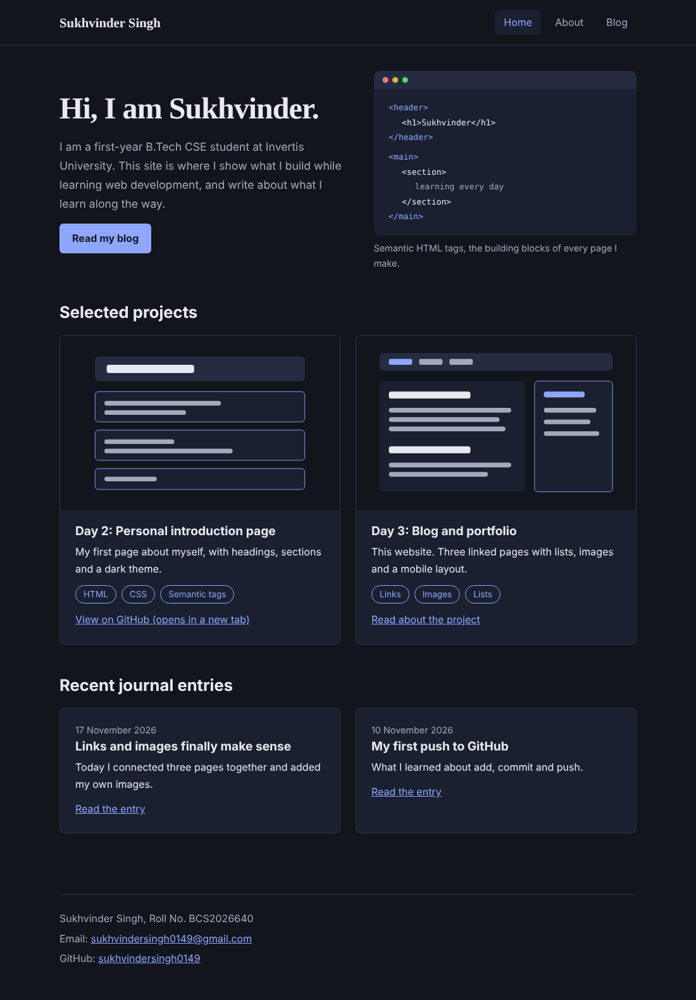
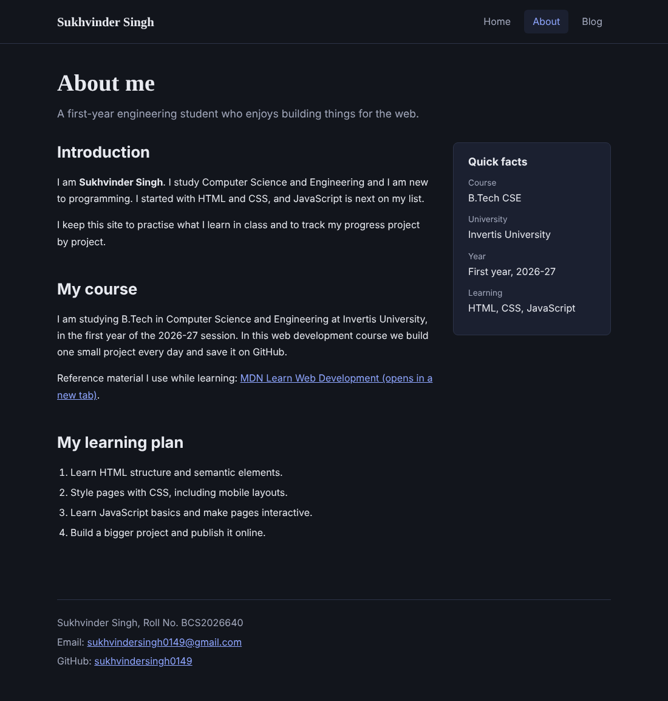
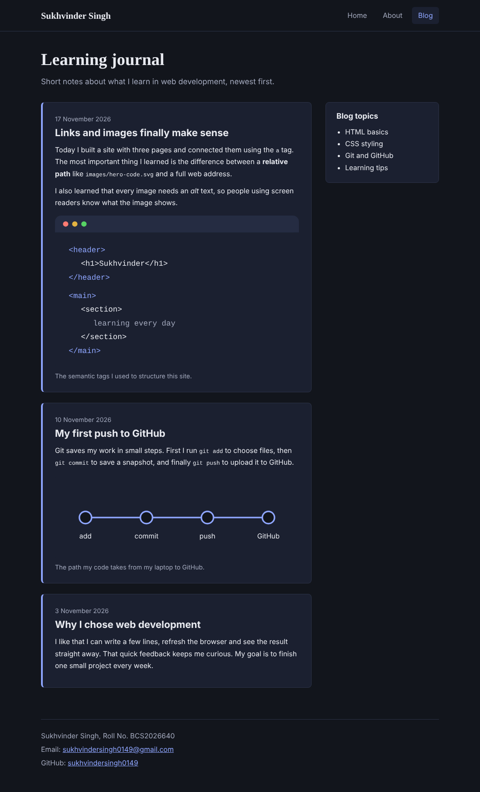
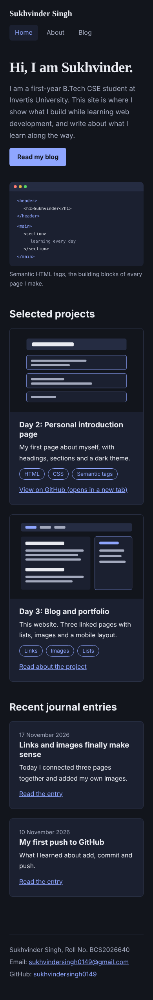

# Day 3: Personal Blog and Portfolio

A responsive dark-themed blog and portfolio for **Sukhvinder Singh**, a first-year B.Tech CSE student at Invertis University (session 2026-27). Built with plain HTML and CSS for the Links, Images, Lists and Semantic HTML assignment.

## Screenshots

Home page:

About page:

Blog page:

Home page on a phone-sized screen:

## What I did in Day 3

- Created three linked pages (`index.html`, `about.html`, `blog.html`) with the same navigation bar on each page.
- Added external links that open in a new tab using `target="_blank"` and `rel="noopener noreferrer"`.
- Added local SVG images in `images/`, used with relative paths and meaningful `alt` text.
- Used lists for navigation, project tags, blog topics and an ordered list for my learning plan.
- Used semantic elements: `header`, `nav`, `main`, `section`, `article`, `aside`, `figure` and `footer`.
- Styled the pages for desktop and mobile screens, using the same dark theme as Day 2.

## Project files

- `index.html` - home page with selected projects and recent journal entries
- `about.html` - introduction, course details and learning plan
- `blog.html` - learning journal entries
- `styles.css` - shared responsive styles
- `images/` - local SVG illustrations
- `screenshots/` - screenshots used in this README

## How to open

No installation is needed. Download the repository, open the folder in VS Code and open `index.html` in a browser (or use the Live Server extension). Keep all files and the `images/` folder together so the links and image paths keep working.

## Author

Sukhvinder Singh, Roll No. BCS2026640
